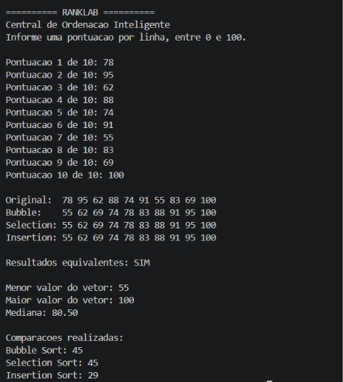
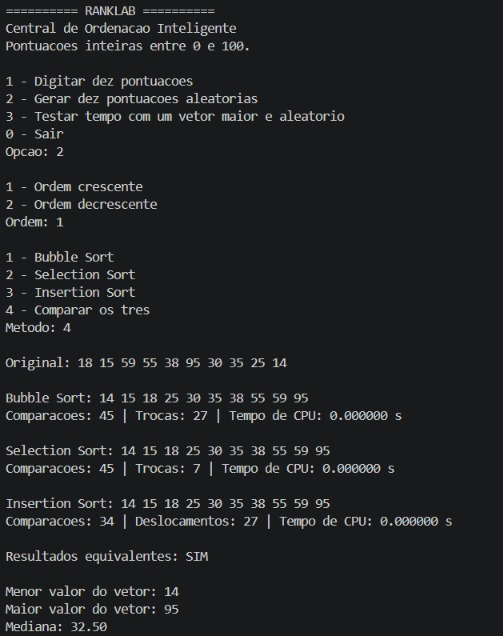
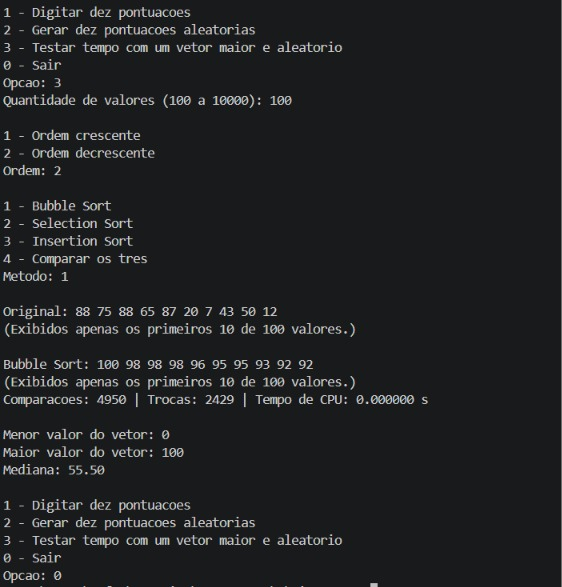

# Projeto 4 RankLab - Algoritmos e Pensamento Computacional
## Integrantes
* [Eloysa Raquel dos Santos](https://github.com/elosantos24) - 47700971
* [Rafael dos Santos Ferreira Lima ](https://github.com/rafael-santos-tech) - 47596295 
* [Cauã Correia de Andrade](https://github.com/cauaandrade2000) - 47766875
* [Nathan Umbelino do Carmo](https://github.com/Nathan1234umbelino-beep) - 47719567

---

## Explicação da Solução

O programa lê dez pontuações validadas entre 0 e 100 (com fgets() e strtol()), preserva o vetor original e cria três cópias independentes com copiarVetor(). Cada cópia é ordenada por um algoritmo diferente, e cada função de ordenação devolve o total de comparações realizadas. Em seguida, vetoresIguais() confirma se os três resultados são iguais. Menor e maior valor são o primeiro e o último elementos do vetor ordenado, e a mediana é a média dos elementos das posições 4 e 5 ((v[4] + v[5]) / 2.0), exibida com duas casas decimais (%.2f). A função main() apenas coordena o fluxo, e nenhuma variável global é utilizada.

---

## Os três métodos
Bubble Sort: compara vizinhos (v[j] e v[j+1]) e troca quando estão fora de ordem. A cada passada, o maior valor restante "sobe" para o fim do vetor.
Selection Sort: a cada posição i, procura o menor elemento do trecho ainda não ordenado e o troca com v[i].
Insertion Sort: guarda o elemento atual (chave), desloca para a direita os maiores que ele na parte já ordenada e o insere na posição correta, como ao organizar cartas na mão.

---

Teste Mínimo Obrigatório

Entradas utilizadas no teste:

Pontuações: 78, 95, 62, 88, 74, 91, 55, 83, 69, 100

Resultado obtido:

Ordenado (os três métodos): 55, 62, 69, 74, 78, 83, 88, 91, 95, 100
Resultados equivalentes: SIM
Menor: 55 | Maior: 100 | Mediana: 80.50
Comparações: Bubble 45 | Selection 45 | Insertion 29

Resultado

---

## Testes 

---
## Desafios Extras:
Ordem de classificação: o usuário escolhe entre ordem crescente ou decrescente.
Trocas e deslocamentos: além das comparações, o programa conta as trocas (Bubble e Selection) e os deslocamentos (Insertion).
Tempo de execução: medição do tempo de CPU com vetores maiores (100 a 10000 valores).
Pontuações aleatórias: geração automática de dez pontuações.
Menu: permite executar um método específico ou comparar os três.
Comparação de Cenários (já ordenado x ordem inversa):
Cenário A (vetor já ordenado): Bubble 45 | Selection 45 | Insertion 9
Cenário B (vetor em ordem inversa): Bubble 45 | Selection 45 | Insertion 45
Conclusão: Bubble e Selection não mudam com a ordem inicial dos dados, enquanto o Insertion Sort passa de 9 para 45 comparações (5 vezes mais), pois só ele aproveita o fato de o vetor já estar ordenado.

---

## # Conclusão da Análise:

Os três métodos chegaram sempre à mesma sequência ordenada, inclusive com valores repetidos, confirmando que as implementações estão corretas. Bubble Sort e Selection Sort realizam sempre 45 comparações com 10 elementos, independentemente da ordem inicial (com 100 elementos, o Bubble fez 4950, ou seja, n(n-1)/2). O Insertion Sort é o único cujo custo depende dos dados: 9 comparações no melhor caso (vetor já ordenado) e 45 no pior (ordem inversa). Quanto às trocas, o Selection Sort fez apenas 7 contra 27 do Bubble Sort na execução extra com 10 valores, mostrando que comparações e trocas medem custos diferentes. Para vetores pequenos, todos os métodos são rápidos (tempo de CPU próximo de zero), e a diferença só tende a aparecer com vetores maiores.
